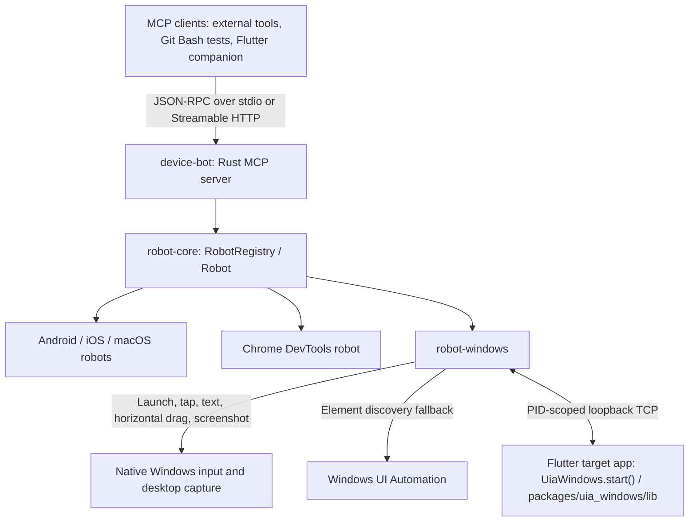

# Cross-platform Automation Kit

This repository contains the `device_kit_lib` Flutter plugin plus the
platform-independent Automation Kit MVP:

```text
lib/src/web/automation_core/  Shared contracts, selectors, and service
lib/src/web/automation_web/   Chrome DevTools Protocol backend
lib/src/web/automation_kit/   Local JSON-RPC CLI/server
bin/device_kit_lib.dart       Root-plugin JSON-RPC entrypoint
```

The root Flutter controller remains a draft package. Production device
automation is implemented by the Rust server under `server/`; applications
are selected dynamically by bundle/package/executable identifier.

## Device-control flow



The Rust MCP server owns sessions and tool dispatch. `RobotRegistry` routes
requests by device ID to the platform's `Robot` implementation. Scenario
waits/retries belong to the client or runner; element queries, filtering and
input dispatch use `robot-core` and the platform drivers.

On Windows, `mobile_launch_app` records the target PID. A Flutter app that calls
`await UiaWindows.start()` registers an optional local bridge. `robot-windows`
prefers that process's widget tree for element discovery and uses native UIA
when the bridge is unavailable. The bridge also handles configured IME actions
and vertical touch swipes. Tap, literal text, horizontal mouse selection and
screenshots use the native Windows paths. Flutter traversal, state extraction,
coordinate conversion and widget actions live in
[`packages/uia_windows/lib`](packages/uia_windows/lib/).

The [Git Bash scenarios](examples/flutter_app/automation_test/README.md) use this
MCP flow. Their `support/windows.ps1` helper prepares and closes the Windows
fixture around each run.

The root Flutter draft retains its own Dart JSON-RPC entrypoint, selectors and
Windows UIA/Web adapters. Pigeon generates the Dart/C++ bindings for that draft
Windows adapter. See the [server README](server/README.md) for the production
MCP interface and platform capabilities.

## Native server implementations

The production server owns the native backends independently of the draft
Flutter package:

- Android: `server/crates/robot-android/`
- iOS: `server/crates/robot-ios-real/` and `server/crates/robot-ios-sim/`
- macOS: `server/crates/robot-macos/`
- Windows: `server/crates/robot-windows/`
- Chrome DevTools: `server/crates/robot-chrome/`

## Root Flutter draft: Windows UI Automation implementation

The root Flutter Windows plugin uses Microsoft UI Automation (UIA) for semantic tree dumps
and element actions, `SendInput` for coordinate/key input, Win32 clipboard
APIs, and Windows Imaging Component (WIC) for PNG desktop screenshots. Every
operation includes the session, operation name, thread, target, process id,
snapshot generation, and native error details in `OutputDebugString` and, when
logging is enabled, in:

```text
%TEMP%\device_kit_lib_windows.log
```

The example controller enables Windows logging automatically. Set
`DEVICE_KIT_LIB_WINDOWS_LOG=1` to force logging for another host. Windows
automation may still be blocked when the controller and target run at
different elevation levels or in different desktop sessions; the log records
the UIA HRESULT and Win32 error needed to diagnose those cases.

### Windows screenshot vision fallback

When Windows UIA produces an empty tree, `DeviceKitAutomationBackend` can turn
a PNG screenshot into coordinate-backed, tappable regions. This is opt-in:
run the local OmniParser sidecar, then set its endpoint before launching the
Flutter controller. It never replaces a non-empty UIA tree and it performs the
final click through the existing native `SendInput` path.

For a partial (rather than empty) UIA tree, construct the backend with
`includeVisionWithNativeElements: true`; this appends detected screenshot
regions after the native elements, preserving native semantics as the first
choice.

```powershell
py -m venv .venv
.\.venv\Scripts\python -m pip install -r tools\windows_vision\requirements.txt
.\.venv\Scripts\python tools\windows_vision\omniparser_sidecar.py
$env:DEVICE_KIT_WINDOWS_VISION_ENDPOINT = 'http://127.0.0.1:18788/locate'
flutter run -d windows
```

On its first run, the sidecar downloads the MIT-licensed
`microsoft/OmniParser-v2.0` `icon_detect_v3` weights through
`huggingface_hub`; set `DEVICE_KIT_OMNIPARSER_MODEL` to a pre-downloaded
`model.pt` for an offline environment. The sidecar remains loopback-only and
returns region coordinates, not click commands. Its low-confidence regions
are a temporary fallback: use normal UIA selectors whenever they are present.

## Chrome control

The same normalized accessibility/action flow can control Chrome after it has
been launched; prefer a semantic address-bar selector and fall back to the
coordinate path only when the platform exposes no semantic element. The mobile
MCP supplies the direct URL-launch operation:

```json
{"name":"mobile_open_url","arguments":{"deviceId":"<device>","appId":"com.android.chrome","url":"https://example.com"}}
```

On Android this starts Chrome with the supplied URL. It was verified on the
connected emulator: `mobile_list_elements_on_screen` subsequently reported
Chrome's `com.android.chrome:id/url_bar` with `example.com`. On a real iPhone,
use the same tool with an installed browser bundle id such as
`com.google.chrome.ios`; it is routed through the signed XCTest agent in
`server/crates/robot-ios-real` and requires that agent to be running.

Production server drivers expose `openUrl(url, appId: ...)` for native targets;
the root Flutter draft retains the Windows UIA and Web/CDP paths only. On
Windows keep Chrome and the controller at the same elevation. If Chrome's
Windows UIA tree is absent or partial, enable the screenshot vision fallback
above; detected regions remain coordinate-only and still click through
`SendInput`.

## iOS XCTest integration

iOS cross-app input is implemented by XCTest/XCUITest in a server-owned
separate product:

```text
server/crates/robot-ios-real/xctest-runner/DeviceKitXCTest/  XCTest/XCUITest driver
```

The `device-kit-lib-xctest` Swift product is linked only by native UI-test
target. `RunnerTests/MobileMcpRealRunnerUITests.swift` imports that product
and uses the driver's raw snapshot and primitive-action API. XCTest is not
linked into the production MCP binary.

## Android server permissions

Android accessibility and screenshot permissions are managed by the production
server's `robot-android` driver. The root Flutter draft no longer ships an
Android plugin or Patrol-based permission harness.

## Run the tests

```bash
flutter test
```

Build and run the iOS XCTest target on a booted simulator:

```bash
cd server/crates/robot-ios-real/xctest-runner
xcodebuild -project Runner.xcodeproj \
  -scheme MobileMcpRealRunnerHost \
  -destination 'platform=iOS Simulator,name=<simulator-name>' \
  test
```

Use `xcodebuild -showdestinations` to select an installed simulator. The
XCTest target launches the bundle id configured by the server runner; it is
not a runtime accessibility service inside the production MCP process.

The local JSON-RPC app reads line-delimited JSON-RPC 2.0 requests from stdin by
default. Start it with `dart run bin/device_kit_lib.dart --http --port 8787`
for a loopback HTTP server.

To drive a connected phone from the host — the same split Mobile MCP uses —
use the Rust server's iOS XCTest agent or Android `adb`/accessibility driver.
This path does not call `@mobilenext/mobilecli`.

The Rust Mobile MCP real-device path is self-contained under `server/*`: it
uses Apple `xcrun devicectl` for paired-device/app lifecycle and a signed
XCTest agent for cross-app UI. It does not require `go-ios`, a userspace tunnel,
or macOS administrator privileges. In one terminal, start the server's
authenticated agent bridge on an address reachable by the iPhone:

```bash
export MOBILE_MCP_IOS_AGENT_BIND=0.0.0.0:18787
export MOBILE_MCP_IOS_AGENT_TOKEN=<long-random-token>
cargo run -p device-bot --manifest-path server/Cargo.toml
```

In another terminal, build the server-owned runner once and then start it for
each MCP session:

```bash
export MOBILE_MCP_IOS_DEVICE=<paired-iPhone-UDID>
export MOBILE_MCP_IOS_AGENT_TOKEN=<same-long-random-token>
server/tool/ios_xctest_agent.sh build
server/tool/ios_xctest_agent.sh start
```

The Rust provisioning command derives the team automatically from the sole
local Apple Development identity and passes `-allowProvisioningUpdates` to
Xcode. If Apple rejects the local account, it opens this server-owned Xcode
project so the user can choose or reauthenticate it. Set
`MOBILE_MCP_IOS_TEAM` only to override the discovered team, or set
`MOBILE_MCP_IOS_SIGNING_IDENTITY=<account-or-certificate-fragment>` when the
Keychain has multiple identities. `start` derives the Mac LAN address automatically when possible; set
`MOBILE_MCP_IOS_AGENT_HOSTS=<mac-lan-ip>` if it cannot. Keep that process
running while MCP calls are made. The local XCTest project is
`server/crates/robot-ios-real/xctest-runner/MobileMcpRealRunner.xcodeproj`.

For the first signed physical-device build, Xcode must have an iOS Development
certificate and profile for both bundle identifiers. After signing into the
intended Apple Developer account in Xcode, you can explicitly allow Xcode to
create or refresh those profiles automatically. The script discovers the team
ID from the local Apple Development certificate; when there is more than one
identity, set `MOBILE_MCP_IOS_TEAM` to override it:

```bash
export MOBILE_MCP_IOS_TEAM=<your-team-id>
server/tool/ios_xctest_agent.sh build
```

This opt-in passes `-allowProvisioningUpdates` to `xcodebuild` and can modify
the selected team's signing records; leave it unset for normal builds.

Without `--device`, the browser backend remains the default.

Selectors are represented by `By.id`, `By.text`, `By.label`, `By.role`,
`By.value`, and `By.all`. They are matched in Dart against normalized
`UiSnapshot` data; browser-specific DOM/CDP details remain inside
`lib/src/web/automation_web`.
