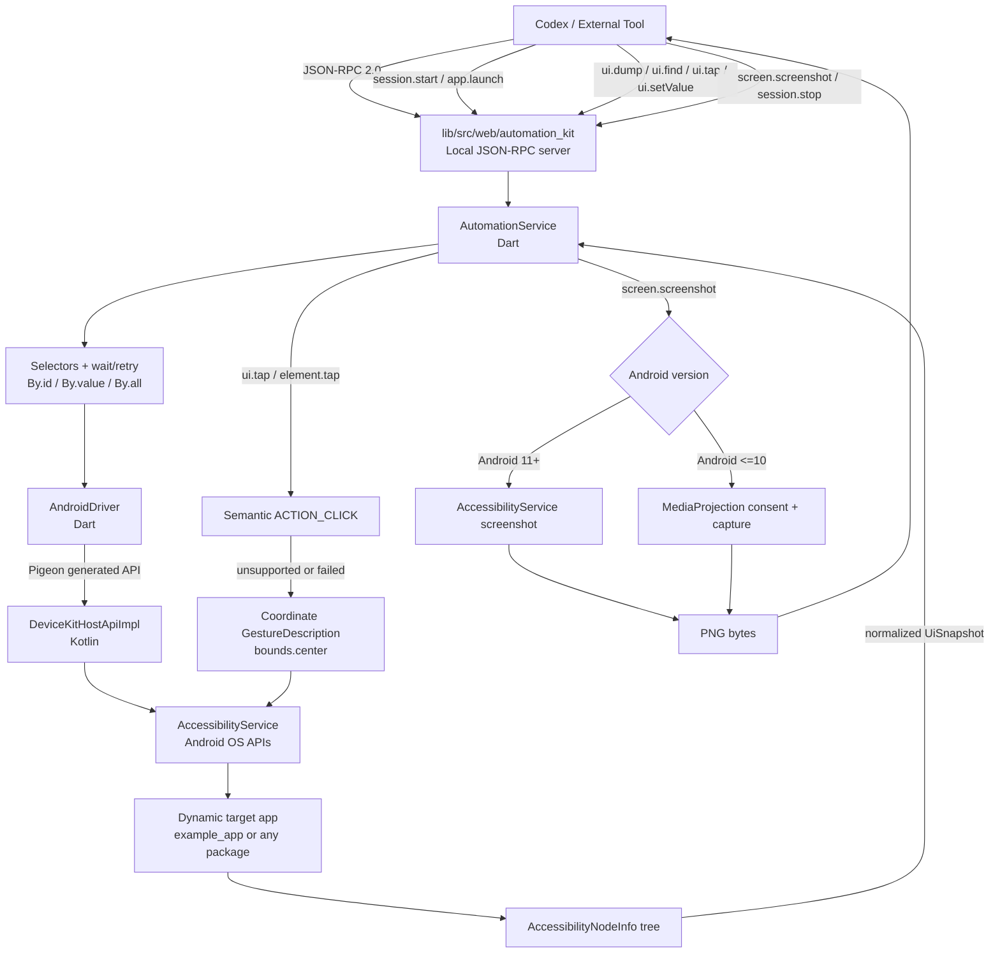

# Cross-platform Automation Kit

This repository contains the `device_kit_lib` Flutter plugin plus the
platform-independent Automation Kit MVP:

```text
lib/src/web/automation_core/  Shared contracts, selectors, and service
lib/src/web/automation_web/   Chrome DevTools Protocol backend
lib/src/web/automation_kit/   Local JSON-RPC CLI/server
bin/device_kit_lib.dart       Root-plugin JSON-RPC entrypoint
example_app/                  Flutter Web counter app with semantics identifiers
```

The Android implementation is a separate controller app and target app:

```text
example/           Device Kit controller app; depends on device_kit_lib
example_app/       Independent target counter app; does not depend on the kit
```

`example` accepts a target Android package name at runtime. The default value
`com.example.example_app` is only a demo target; the native `launchApp` API is
dynamic and does not contain a target package allow-list.

## Device-control flow

```text
                    External tools
                         │
                    JSON-RPC
                         │
              ┌──────────▼──────────┐
              │ Automation Agent    │
              │ Dart Core           │
              │                     │
              │ socket server       │
              │ session             │
              │ selector            │
              │ wait/retry          │
              └──────────┬──────────┘
                         │
                    PlatformDriver
                         │
       ┌────────┬────────┼────────┬────────┬────────┐
       │        │        │        │        │        │
    Android   iOS      macOS    Windows  Linux     Web
       │        │        │        │        │        │
Accessibility XCTest    AX       UIA    AT-SPI   BiDi
                   runner
```



The Android plugin uses Pigeon from `pigeons/messages.dart`. Generated Dart,
Kotlin, Swift, and C++ bindings are kept in their platform output folders.
Selectors and retry/wait logic remain in Dart; Android only exposes
AccessibilityService and OS capabilities.

The root plugin adapts the Pigeon-backed Android/iOS/macOS `DeviceDriver`
through `DeviceKitAutomationBackend`. The three Automation Kit layers now live
under `lib/src/web/`, so the shared `AutomationService` can drive native
devices and the CDP browser with the same selector contract.

## Shared iOS/macOS implementation

The iOS and macOS plugin sources share `darwin/device_kit_lib/` through
`sharedDarwinSource: true`. Pigeon generates one Swift contract at
`darwin/device_kit_lib/Sources/device_kit_lib/Messages.g.swift`; conditional
Swift files select UIKit/XCTest behavior on iOS and the macOS Accessibility
API (`AXUIElement`) on macOS. macOS automation requires the host application
to be trusted under **System Settings > Privacy & Security > Accessibility**.

Build or run the macOS example with Flutter:

```bash
cd example
flutter run -d macos
```

Before calling cross-application AX actions, add the example app (or the
host application that embeds this plugin) to the macOS Accessibility allowlist.
The host process must also be allowed to use macOS Accessibility APIs; the
example controller therefore disables App Sandbox in its macOS entitlements.

## Windows UI Automation implementation

The Windows plugin uses Microsoft UI Automation (UIA) for semantic tree dumps
and element actions, `SendInput` for coordinate/key input, Win32 clipboard
APIs, and Windows Imaging Component (WIC) for PNG desktop screenshots. Every
operation includes the session, operation name, thread, target, process id,
snapshot generation, and native error details in `OutputDebugString` and, when
logging is enabled, in:

```text
%TEMP%\device_kit_lib_windows.log
```

The example controller enables Windows logging automatically. Set
`DEVICE_KIT_LIB_WINDOWS_LOG=1` to force logging for another host. Windows
automation may still be blocked when the controller and target run at
different elevation levels or in different desktop sessions; the log records
the UIA HRESULT and Win32 error needed to diagnose those cases.

### Windows screenshot vision fallback

When Windows UIA produces an empty tree, `DeviceKitAutomationBackend` can turn
a PNG screenshot into coordinate-backed, tappable regions. This is opt-in:
run the local OmniParser sidecar, then set its endpoint before launching the
Flutter controller. It never replaces a non-empty UIA tree and it performs the
final click through the existing native `SendInput` path.

For a partial (rather than empty) UIA tree, construct the backend with
`includeVisionWithNativeElements: true`; this appends detected screenshot
regions after the native elements, preserving native semantics as the first
choice.

```powershell
py -m venv .venv
.\.venv\Scripts\python -m pip install -r tools\windows_vision\requirements.txt
.\.venv\Scripts\python tools\windows_vision\omniparser_sidecar.py
$env:DEVICE_KIT_WINDOWS_VISION_ENDPOINT = 'http://127.0.0.1:18788/locate'
flutter run -d windows
```

On its first run, the sidecar downloads the MIT-licensed
`microsoft/OmniParser-v2.0` `icon_detect_v3` weights through
`huggingface_hub`; set `DEVICE_KIT_OMNIPARSER_MODEL` to a pre-downloaded
`model.pt` for an offline environment. The sidecar remains loopback-only and
returns region coordinates, not click commands. Its low-confidence regions
are a temporary fallback: use normal UIA selectors whenever they are present.

## Chrome control

The same normalized accessibility/action flow can control Chrome after it has
been launched; prefer a semantic address-bar selector and fall back to the
coordinate path only when the platform exposes no semantic element. The mobile
MCP supplies the direct URL-launch operation:

```json
{"name":"mobile_open_url","arguments":{"deviceId":"<device>","appId":"com.android.chrome","url":"https://example.com"}}
```

On Android this starts Chrome with the supplied URL. It was verified on the
connected emulator: `mobile_list_elements_on_screen` subsequently reported
Chrome's `com.android.chrome:id/url_bar` with `example.com`. On a real iPhone,
use the same tool with an installed browser bundle id such as
`com.google.chrome.ios`; it is routed through the signed XCTest agent in
`server/crates/robot-ios-real` and requires that agent to be running.

All native drivers also expose `openUrl(url, appId: ...)`; the shared
`DeviceKitAutomationBackend` selects it automatically when `launch` receives
an HTTP(S) target. Use `com.android.chrome` on Android,
`com.google.chrome.ios` on iOS, `com.google.Chrome` on macOS, and `chrome.exe`
(or the full executable path) on Windows. iOS selects Chrome with its public
`googlechrome(s)` URL scheme; omitting `appId` opens the system default browser.
The macOS AX and Windows UIA drivers then dump, select, set the address value,
and press browser controls through the same `AutomationService` contract.
Grant Accessibility to the macOS controller; on Windows keep Chrome and the
controller at the same elevation. If Chrome's Windows UIA tree is absent or
partial, enable the screenshot vision fallback above; detected regions remain
coordinate-only and still click through `SendInput`.

## One scenario for all platforms

The shared counter flow is defined once in
`packages/scenarios/ex_scenario_1.yaml`. The Android/iOS/macOS/Windows native
integration test and the Web CDP E2E both consume that file. Override the
Windows executable path on the real machine with
`EXAMPLE_APP_WINDOWS_TARGET`.

Native example run:

```bash
cd example
flutter test integration_test/scenario_test.dart -d windows
```

Web E2E run:

```bash
RUN_WEB_E2E=1 flutter test e2e/example_app_e2e_test.dart
```

## iOS XCTest integration

iOS cross-app input is implemented by XCTest/XCUITest in a separate product
exported by the plugin:

```text
darwin/device_kit_lib/Sources/device_kit_lib/          Flutter/Pigeon runtime
darwin/device_kit_lib/Sources/device_kit_lib_xctest/  XCTest/XCUITest driver
```

The `device-kit-lib-xctest` Swift product is linked only by native UI-test
targets. `example_app/ios/RunnerUITests` imports that product and uses the
driver's raw snapshot and primitive-action API; selector and wait/retry logic
remain in Dart. XCTest is therefore reusable by native app test targets
without being linked into the production Flutter plugin.

## Android permissions

The controller must have its `DeviceKitAccessibilityService` enabled by the
device owner or test environment. This is a special Settings permission, not a
normal runtime permission, so Patrol's `grantPermissionWhenInUse()` cannot grant
it. Patrol can be used in a test harness to tap through the device's Settings
UI, but that flow is Android/OEM/localization-specific and is intentionally not
a runtime dependency of this plugin.

On Android 11 and newer, screenshots use AccessibilityService directly. On
older Android versions, screenshots require the user to approve the
MediaProjection consent dialog through the controller's **Request screenshot
permission** button before calling **Take screenshot**.

## Run the tests

```bash
flutter test
cd example_app && flutter test
```

Build the example app for local browser automation:

```bash
cd example_app
flutter build web --no-web-resources-cdn
```

Run the browser E2E (Chrome/Chromium is required):

```bash
RUN_WEB_E2E=1 flutter test e2e/example_app_e2e_test.dart
```

Run the Android self-test on a connected device (Patrol CLI is required):

```bash
cd example
patrol test --target patrol_test/android_automation_test.dart
```

The Patrol test is test-only setup. It can navigate Android Settings to enable
the Device Kit AccessibilityService and can approve the MediaProjection dialog;
the target-app UI dump, selectors, wait, tap, and screenshot calls still use
the shared `device_kit_lib` Dart API.

Build and run the iOS XCTest target on a booted simulator:

```bash
cd example_app/ios
xcodebuild -project Runner.xcodeproj \
  -scheme Runner \
  -destination 'platform=iOS Simulator,name=<simulator-name>' \
  test
```

Use `xcodebuild -showdestinations` to select an installed simulator. The
XCTest target launches `com.example.exampleApp` itself; it is not a runtime
accessibility service inside the production Flutter process.

The local JSON-RPC app reads line-delimited JSON-RPC 2.0 requests from stdin by
default. Start it with `dart run bin/device_kit_lib.dart --http --port 8787`
for a loopback HTTP server.

To drive a connected phone from the host — the same split Mobile MCP uses —
pass a device id or name. iOS uses the plugin's XCTest runner
(`DeviceKitXCTestDriver`) as an on-device agent; Android uses `adb` and
`uiautomator dump`. This path does not call `@mobilenext/mobilecli`.

```bash
DEVICE_KIT_IOS_PROJECT=/path/to/ios/Runner.xcodeproj \
  dart run bin/device_kit_lib.dart --device <device-id-or-name> --http --port 8787
```

`DEVICE_KIT_IOS_PROJECT` is the Xcode project that owns the signed UI-test
runner. The included `example_app/ios/Runner.xcodeproj` is a ready-to-build
counter-demo runner; a product app can use its own project after adding the
same `DeviceKitHttpAgentTests/testServe` UI test. `session.start` only
connects to the running XCTest agent (same model as Mobile MCP expecting
WebDriverAgent on port 8100); it does not invoke `xcodebuild` itself.

Build the agent **once**, then start the last products (no compile):

```bash
cd example_app && flutter pub get && cd ..
export DEVICE_KIT_IOS_PROJECT="$PWD/example_app/ios/Runner.xcodeproj"
export DEVICE_KIT_DEVICE=<paired-iPhone-UDID-or-name>
tool/ios_xctest_agent.sh build    # first time, or after Swift/agent changes
tool/ios_xctest_agent.sh start    # every later session
```

Before the first build, open the project in Xcode and select your Apple
development team for both `Runner` and `RunnerUITests`; the phone must trust
that certificate. Keep `start` running, then call `session.start`. The target
app is whatever bundle id you pass to `app.launch`. The iPhone and Mac must
be on the same Wi-Fi, and macOS must allow the test bundle's local-network HTTP
connection when prompted. If Xcode needs a precise destination rather than a
visible device name, set `DEVICE_KIT_IOS_DESTINATION` to the complete
`platform=iOS,id=<xcode-destination-id>` value shown by
`xcodebuild -showdestinations`.

The Rust Mobile MCP real-device path is self-contained under `server/*`: it
uses Apple `xcrun devicectl` for paired-device/app lifecycle and a signed
XCTest agent for cross-app UI. It does not require `go-ios`, a userspace tunnel,
or macOS administrator privileges. In one terminal, start the server's
authenticated agent bridge on an address reachable by the iPhone:

```bash
export MOBILE_MCP_IOS_AGENT_BIND=0.0.0.0:18787
export MOBILE_MCP_IOS_AGENT_TOKEN=<long-random-token>
cargo run -p mobile-mcp-server --manifest-path server/Cargo.toml
```

In another terminal, build the server-owned runner once and then start it for
each MCP session:

```bash
export MOBILE_MCP_IOS_DEVICE=<paired-iPhone-UDID>
export MOBILE_MCP_IOS_AGENT_TOKEN=<same-long-random-token>
server/tool/ios_xctest_agent.sh build
server/tool/ios_xctest_agent.sh start
```

The Rust provisioning command derives the team automatically from the sole
local Apple Development identity and passes `-allowProvisioningUpdates` to
Xcode. If Apple rejects the local account, it opens this server-owned Xcode
project so the user can choose or reauthenticate it. Set
`MOBILE_MCP_IOS_TEAM` only to override the discovered team, or set
`MOBILE_MCP_IOS_SIGNING_IDENTITY=<account-or-certificate-fragment>` when the
Keychain has multiple identities. `start` derives the Mac LAN address automatically when possible; set
`MOBILE_MCP_IOS_AGENT_HOSTS=<mac-lan-ip>` if it cannot. Keep that process
running while MCP calls are made. The local XCTest project is
`server/crates/robot-ios-real/xctest-runner/MobileMcpRealRunner.xcodeproj`;
`example_app` is not used by the server runtime.

For the first signed physical-device build, Xcode must have an iOS Development
certificate and profile for both bundle identifiers. After signing into the
intended Apple Developer account in Xcode, you can explicitly allow Xcode to
create or refresh those profiles automatically. The script discovers the team
ID from the local Apple Development certificate; when there is more than one
identity, set `MOBILE_MCP_IOS_TEAM` to override it:

```bash
export MOBILE_MCP_IOS_TEAM=<your-team-id>
server/tool/ios_xctest_agent.sh build
```

This opt-in passes `-allowProvisioningUpdates` to `xcodebuild` and can modify
the selected team's signing records; leave it unset for normal builds.

Without `--device`, the browser backend remains the default.

Selectors are represented by `By.id`, `By.text`, `By.label`, `By.role`,
`By.value`, and `By.all`. They are matched in Dart against normalized
`UiSnapshot` data; browser-specific DOM/CDP details remain inside
`lib/src/web/automation_web`.
