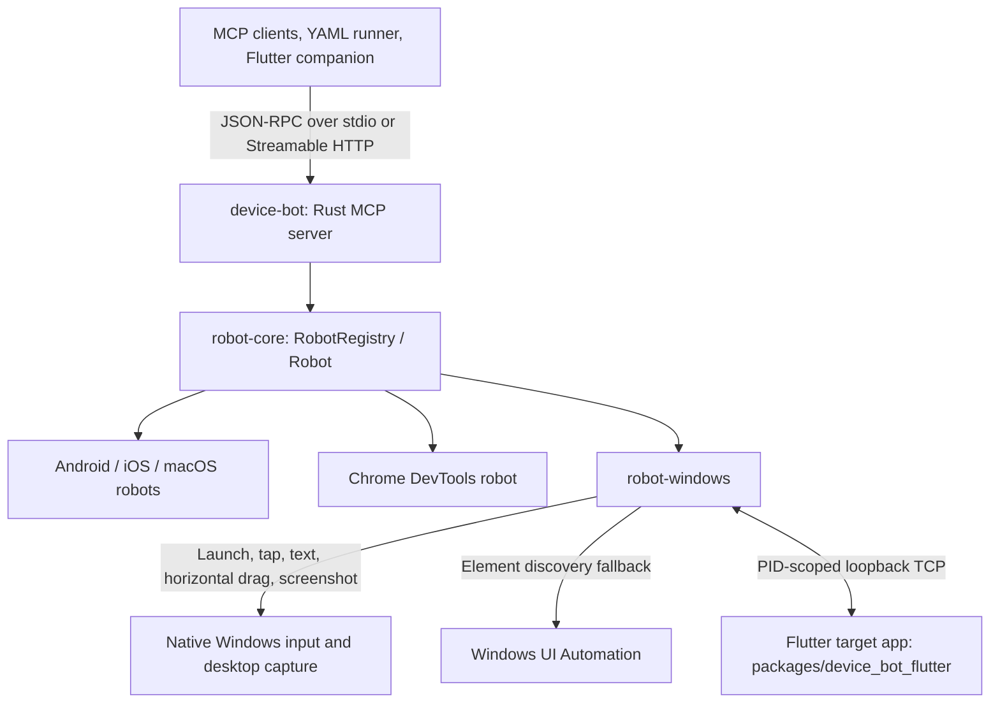

# Device Bot

Native device automation through a Rust MCP server, YAML scenarios, and a
persistent QA report web app. Supported backends cover Android, iOS Simulator,
physical iPhone, macOS, Windows, and Chrome DevTools. See the
[platform matrix](server/README.md) for the operations available on each target.

## Run

The installed native suite uses `device-bot` as its entry point:

```sh
device-bot                       # Start the background web app and open localhost:8765
device-bot start                 # Start the web app only when it is not running
device-bot mcp                   # Run the MCP server over stdio
device-bot run scenario.yaml     # Execute a YAML scenario
```

The web app keeps running after the terminal closes. Its history lives in
`~/.device-bot/reports`; set `DEVICE_BOT_REPORT_DATA_DIR` before startup to use
another store. MCP clients must pass `mcp` as an argument.

Build the native suite from the repository root:

```sh
cargo build --manifest-path server/Cargo.toml --release --locked \
  -p device-bot -p robot-flow -p robot-report
server/target/release/device-bot start
```

See the [server guide](server/README.md) for installation, HTTP transport,
platform setup, and the optional Flutter companion. The
[YAML guide](server/docs/yaml-mcp-client.md) describes scenario execution;
[robot-report](server/crates/robot-report/README.md) documents projects, history,
failed steps, and evidence downloads.

## Repository layout

| Path | Purpose |
| --- | --- |
| `server/crates/` | Native MCP server, platform drivers, YAML runner, report service |
| `server/flutter_app/` | Optional Flutter MCP client for manual control and flow authoring |
| `packages/device_bot_flutter/` | Optional Flutter discovery fallback for native drivers and web |
| `examples/flutter_app/` | Orbit fixture app, integration tests, and automation scenarios |
| `scripts/` | Native release packaging and installers |

The former root Flutter controller and its Pigeon/C++ Windows plugin have been
removed. This repository root is no longer a Flutter package. The companion,
Windows bridge, and fixture app each retain their own `pubspec.yaml`.

## Device-control flow



The Rust server owns sessions and tool dispatch. `RobotRegistry` routes
requests by device ID to platform drivers; scenario waits and retries belong
to the YAML runner or MCP client. Driver ownership and dependency rules are
documented in [architecture.md](server/docs/architecture.md).

On Windows, `mobile_launch_app` records the target PID. A Flutter target can
call `await DeviceBotFlutter.start()` to expose its widget tree through
[`packages/device_bot_flutter`](packages/device_bot_flutter/README.md). The native driver
queries native accessibility first and uses that process's bridge only when no elements match. The bridge also
supports configured IME actions and vertical touch swipes; desktop input and
capture remain in `robot-windows`.

The [Orbit automation scenarios](examples/flutter_app/automation_test/README.md)
exercise this MCP flow. Native iOS XCTest runners remain owned by
`server/crates/robot-ios-sim` and `server/crates/robot-ios-real`.

## Verification

Run native tests and packaging checks from the repository root:

```sh
cargo test --manifest-path server/Cargo.toml --workspace --locked
node --test server/crates/robot-chrome/tests/dom-elements.test.cjs
python3 scripts/test_package_release.py
```

Run Flutter checks from the package being tested:

```sh
cd packages/device_bot_flutter
flutter pub get
flutter analyze --no-pub
flutter test --no-pub
```

The [fixture app](examples/flutter_app/README.md) and
[companion](server/flutter_app/README.md) provide their own run and test
instructions. The native CLI does not require Flutter to start its MCP server
or QA report web app.
