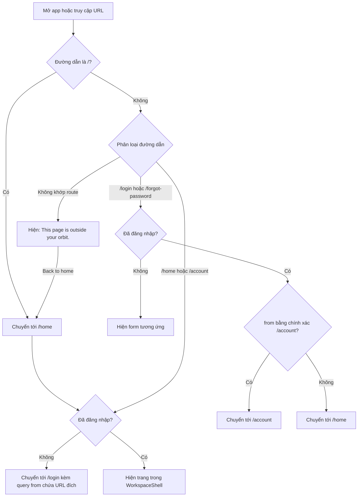
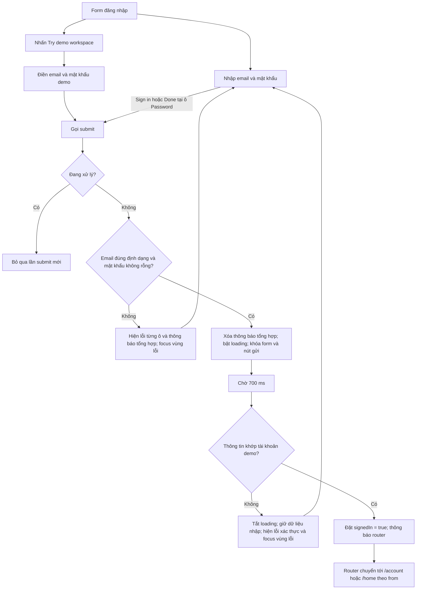
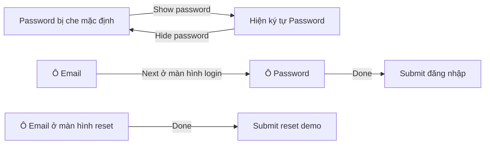
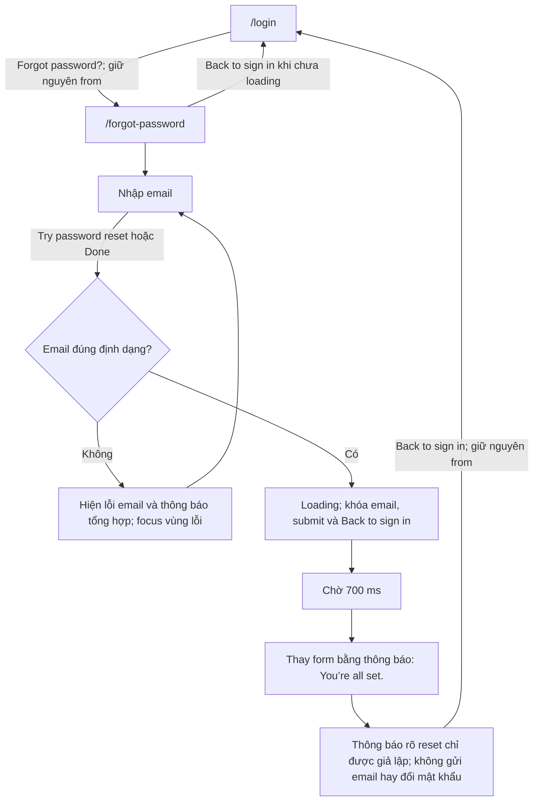
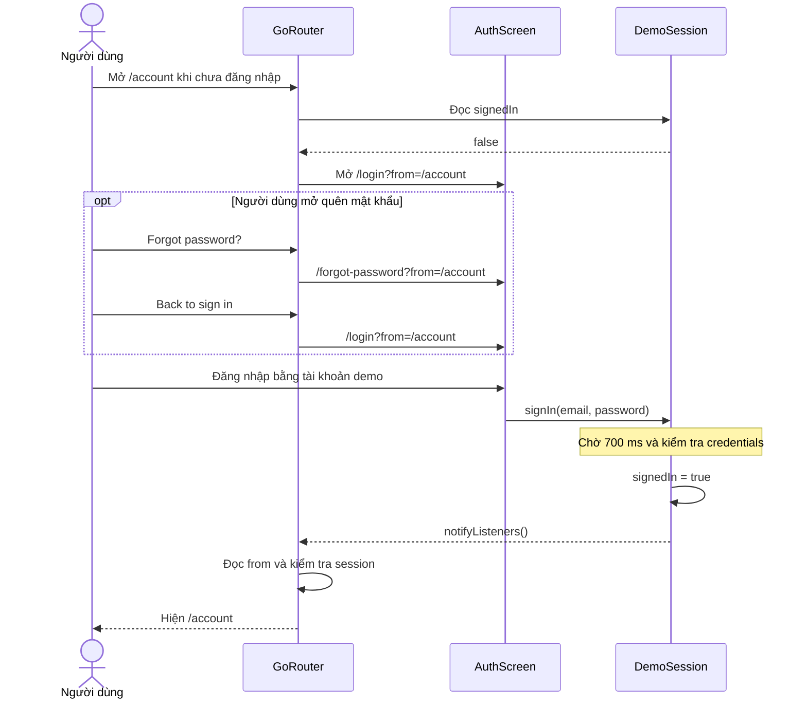
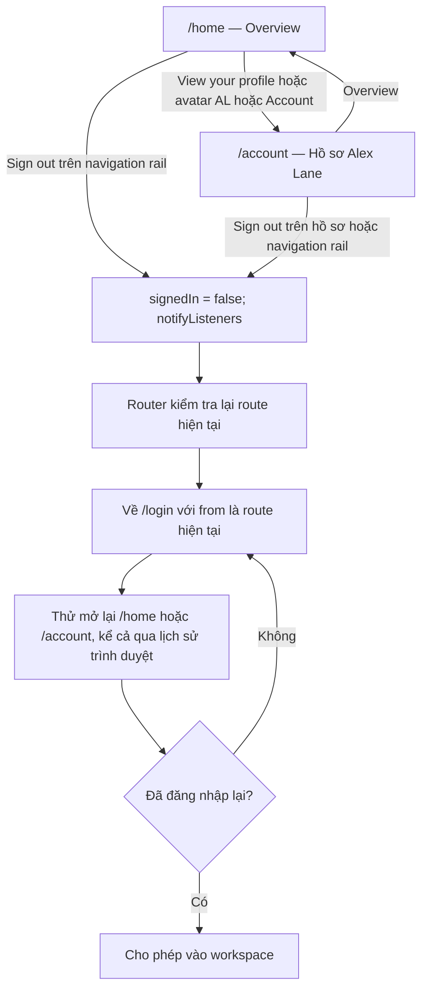
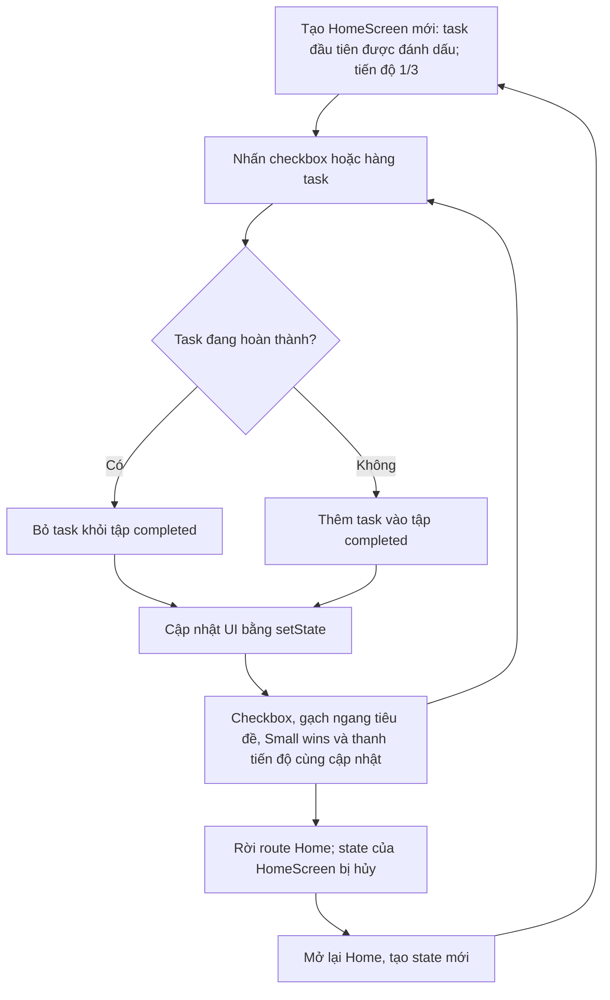
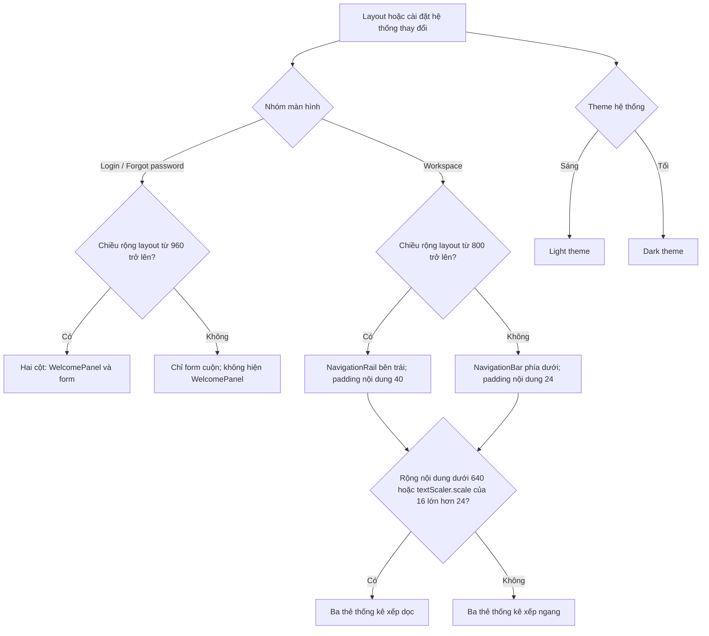
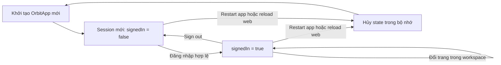

# Orbit — Các flow và behavior của app

Tài liệu mô tả behavior đang được triển khai trong `examples/flutter_app`.
Các nhãn nút và thông báo giữ nguyên tiếng Anh để đối chiếu trực tiếp với giao diện.

App xác thực bằng dữ liệu demo trong bộ nhớ, không gọi backend, gửi email hoặc lưu token.

| Thông tin | Giá trị |
|---|---|
| Email demo | `alex@orbit.demo` |
| Mật khẩu demo | `Orbit123!` |
| Hồ sơ hiển thị | Alex Lane, avatar AL |
| Thời gian giả lập đăng nhập/reset | 700 ms |
| URL web ví dụ | `/#/account` |

## 1. Khởi động và bảo vệ route



| Route | Route name | Quyền truy cập / behavior |
|---|---|---|
| `/` | — | Redirect tới `/home`, sau đó áp dụng kiểm tra phiên |
| `/login` | `login` | Form đăng nhập; người đã đăng nhập được redirect |
| `/forgot-password` | `forgot-password` | Form reset demo; người đã đăng nhập được redirect |
| `/home` | `home` | Cần đăng nhập; trang tổng quan và checklist |
| `/account` | `account` | Cần đăng nhập; hồ sơ và đăng xuất |
| Đường dẫn không tồn tại | — | Trang lỗi có nút quay về Home, kể cả khi đã đăng nhập |

`from` lưu toàn bộ URI được yêu cầu, nhưng redirect sau đăng nhập hiện chỉ nhận
**chính xác** `/account`; các giá trị khác đều về `/home`. Ví dụ,
`from=/account?tab=profile` sẽ về `/home`, không phục hồi query của trang tài khoản.

## 2. Đăng nhập bằng email/mật khẩu hoặc tài khoản demo



Quy tắc hiện tại:

- Email được trim trước khi kiểm tra định dạng; khi xác thực còn được chuyển thành chữ thường.
- Mật khẩu chỉ được kiểm tra không rỗng tại form. Khi xác thực, mật khẩu phải khớp chính xác `Orbit123!`, phân biệt hoa/thường và không trim.
- Email sai định dạng: `Enter a valid email address.`
- Mật khẩu rỗng: `Enter your password.`
- Form không hợp lệ: `Check the highlighted fields to continue.`
- Sai tài khoản: `Email or password is incorrect. Try the demo account below.`
- Validation chạy khi submit. Sửa nội dung chưa tự xóa thông báo lỗi tổng hợp; submit hợp lệ sẽ xóa thông báo đó trước khi xử lý.
- Khi loading, email, mật khẩu, `Sign in`, `Forgot password?` và `Try demo workspace` bị vô hiệu hóa. Nút hiện/ẩn mật khẩu vẫn dùng được.
- Spinner có nhãn accessibility `Please wait`. Vùng lỗi dùng live region và được yêu cầu focus khi có lỗi.
- Khi đăng nhập thành công, code gọi hoàn tất autofill nếu màn hình vẫn còn mounted. Router chịu trách nhiệm chuyển trang theo thay đổi session.

## 3. Nhập liệu và hiện/ẩn mật khẩu



Form có nhãn ô nhập, bàn phím email, nhóm autofill và gợi ý username/email/password.
Đổi trạng thái hiện/ẩn không thay đổi nội dung mật khẩu; app không chặn thao tác paste.
Thông tin tài khoản demo hiển thị dưới dạng văn bản có thể chọn/copy.

## 4. Quên mật khẩu demo



Bất kỳ email đúng định dạng nào cũng nhận kết quả reset demo; không kiểm tra email
có thuộc tài khoản demo hay không. Luồng này không đăng nhập người dùng, không có
màn hình nhập mật khẩu mới và không thay đổi credentials.

## 5. Deep link và quay lại trang đích sau đăng nhập



Nếu mở app qua `/`, chuỗi redirect ban đầu là `/` → `/home` →
`/login?from=/home` khi chưa có phiên. Mở `/login` trực tiếp không có `from`
sẽ về `/home` sau đăng nhập thành công.

## 6. Điều hướng workspace và đăng xuất



- `ShellRoute` cung cấp app bar và thanh điều hướng chung. Mục được chọn dựa trên route hiện tại.
- Avatar `AL` luôn mở trang Account. Trang Account hiển thị hồ sơ demo, email có thể chọn/copy và nút đăng xuất.
- Navigation rail có nút đăng xuất riêng trên màn hình rộng; màn hình hẹp đăng xuất từ Account.
- Đăng xuất có hiệu lực ngay, không có hộp thoại xác nhận.
- App dùng `goNamed`; không tự thêm nút Back nội bộ hay quy định số lần nhấn Back của trình duyệt. Mỗi lần vào route được bảo vệ đều phải qua kiểm tra session.

## 7. Checklist và tiến độ trên Home



Có ba task cố định:

1. `Make space for a fresh start` — `5 min · A little planning`.
2. `Choose your most important task` — `10 min · Set your intention`.
3. `Take a mindful break` — `5 min · Recharge`.

`Small wins` bằng số task được chọn trên tổng 3; thanh tiến độ bằng số task được
chọn chia 3. Nhãn accessibility thông báo số task hoàn thành. Các thẻ `20 min`
và `Today` là nội dung cố định, không phải bộ đếm thời gian hoặc dữ liệu tính từ checklist.

Checklist chỉ nằm trong state của `HomeScreen`, không lưu trong session/backend.
Vì vậy rời Home sang Account rồi quay lại cũng khởi tạo checklist về `1/3`.

## 8. Bố cục responsive và theme

Các ngưỡng dưới đây tính theo logical pixel của Flutter; ngưỡng của cụm thẻ thống
kê dựa trên chiều rộng nội dung còn lại sau padding và navigation rail.



Form có chiều rộng tối đa 420; nội dung workspace tối đa 1040. Các trang nội dung
cuộn độc lập trong viewport của Navigator; `SafeArea` bảo vệ vùng nội dung khỏi
system inset. App dùng cỡ chữ hệ thống và không có công tắc theme riêng.

## 9. Vòng đời dữ liệu demo



Session không có thời hạn tự hết, chức năng remember me hoặc lưu bền vững. Hot
reload có thể giữ State hiện có; không tương đương hot restart hoặc reload trang web.
Dữ liệu nhập form và trạng thái reset cũng nằm trong bộ nhớ của màn hình tương ứng.

## 10. Nguồn đối chiếu và kiểm thử hiện có

| Nhóm behavior | Nguồn triển khai | Kiểm thử hiện có |
|---|---|---|
| Route guard, deep link, fallback, redirect | [main.dart](lib/main.dart) | Truy cập Account khi chưa đăng nhập, quay về Account sau login, route không tồn tại, chặn Home sau logout |
| Xác thực demo và vòng đời session | [session.dart](lib/session.dart) | Login demo và từ chối mật khẩu sai qua widget test |
| Validation, loading, password visibility | [auth_screen.dart](lib/screens/auth_screen.dart) | Lỗi ô nhập, đổi tooltip hiện/ẩn, nút submit bị khóa khi loading |
| Reset demo và giữ `from` | [auth_screen.dart](lib/screens/auth_screen.dart) | Email không hợp lệ, kết quả reset, quay về login rồi vào Account |
| Điều hướng, profile, logout, checklist | [workspace_screen.dart](lib/screens/workspace_screen.dart) | Tick task thứ hai thành `2/3`, mở profile và logout |
| Responsive, theme, chữ lớn | [theme.dart](lib/theme.dart), các màn hình | Login → Home → Account → Logout ở 375×812, 812×375, 768×1024, 1440×900; text scale 1/light và 2/dark; disableAnimations bật |

Bộ test nằm tại [widget_test.dart](test/widget_test.dart). Các mô tả chi tiết như
chuẩn hóa email, `from` có query, reset checklist sau khi rời Home và breakpoint
được đối chiếu từ source; chưa có test riêng cho từng nhánh đó.

```sh
cd examples/flutter_app
flutter test
```
