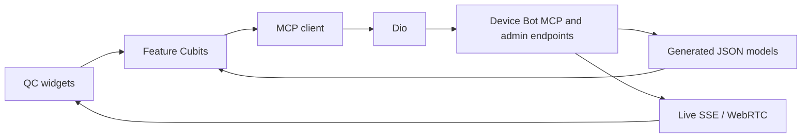

# Device Bot Companion

The optional Flutter desktop companion connects to the local Device Bot server's
MCP endpoint at `/mcp`, using the same initialize/session/tools contract as any
other MCP client. It displays devices, local MCP activity, and on-demand device
screenshots. The screenshot inspector also finds all accessibility
elements, overlays their bounds and names, and provides a small `robot-flow` YAML
editor for drafting a scenario around the selected element. MCP handles device
tools; authenticated admin endpoints supply Live event streams and low-latency
input.

For iOS Simulator, the target app must first be launched through Device Bot
(for example with `mobile_launch_app`) before the inspector can query XCTest
accessibility elements. The inspector keeps the screenshot visible and shows
this recovery hint when no active app is known.

Normally, starting the Rust server in this repository automatically launches
this Flutter project after the HTTP listener is ready. To run the companion
manually instead:

```bash
cd ..
DEVICE_BOT_FLUTTER_AUTOSTART=0 \
  cargo run -p device-bot -- --listen 127.0.0.1:3337
```

The server prints the generated bearer token. Then run this Flutter project
with the same URL and token, for example:

```bash
flutter run -d macos \
  --dart-define=DEVICE_BOT_URL=http://127.0.0.1:3337 \
  --dart-define=DEVICE_BOT_AUTH=replace-with-the-printed-token
```

The companion connects to an existing server and does not start or stop it.

## Project structure

The app uses Cubit from `flutter_bloc` for connection, device dialogs, inspector
selection and YAML drafts, flow execution/review and Live state. Dio owns HTTP
requests and cancellation. Wire models use
`json_serializable`, generated with `build_runner`.

```text
lib/
  main.dart                  # Bootstrap and Flutter inspection bridge
  app/qc_app.dart             # MaterialApp and shared theme
  core/
    models/                  # Shared wire models and generated JSON code
    network/                 # MCP session, Dio, native/web stream adapters
    platform/                # Platform-specific local connection discovery
  features/
    connection/              # ConnectionCubit and companion page
    devices/                 # Dialog Cubits, coordinate helpers, dashboard/UI
    inspector/               # InspectorCubit, snapshots, YAML helpers, UI
    flows/                   # FlowRunCubit, execution and review dialogs
    live/                    # LiveCubit, WebRTC, recording storage and UI
```

Widgets retain rendering resources, text/scroll controllers and gesture
coordinates. State changes render through BlocBuilder/BlocConsumer; application
code does not call `setState`. Cubits own asynchronous requests and prevent stale
responses from replacing a new connection, process or inspector selection.
The connection Cubit uses a separate
health session so readiness polling can continue during long tool calls.
LiveCubit owns stream subscriptions, video sessions, reconnect timers, element
selection and the input queue. Closing it cancels subscriptions, releases video
resources and prevents queued input from starting.



The web adapter uses Fetch streams for SSE so Live receives events before the
response ends. Cancelling a subscription aborts its request. Regular web
requests use Dio's browser adapter; native requests use its native adapter.

## Development checks

Run these commands from this directory:

```bash
flutter pub get
dart run build_runner build
flutter analyze
flutter test
flutter test --platform chrome test/browser/streaming_adapter_test.dart
flutter build web --release --base-href /qc/
```

Commit generated `lib/core/models/*.g.dart` with model changes. Edit the source
models rather than generated files. Browser tests exercise streaming and
cancellation with an open SSE response; native/widget tests cover MCP sessions,
authentication, Cubit races, inspector selection and existing control flows.

JSON models are grouped by protocol: MCP, Live, runner readiness, installed apps,
web context, flow reports and local connection profiles. The shared Flutter
bridge owns its models in `packages/device_bot_flutter/lib/src/bridge_protocol.dart`.
See the [JSON contract audit](../../docs/qc-json-refactor-audit.md) for the enum
policies and the exact remaining custom converters/map boundaries, including why
each is retained.

The reusable [QC automation workflow](../../.github/workflows/automation-tests.yml)
checks generation, analysis, tests and the web build before replaying the web
YAML suite on Linux and Windows.

## Live control and web deployment

Live control is available for Android and Chrome. Select an element to inspect
it, then use **Tap selected** to control it. **Up 50 px / Down 50 px** send pixel
scroll commands. Successful actions are recorded automatically; **Export YAML**
saves a complete `robot-flow` v2 scenario for the current platform. Run it with:

```bash
device-bot run /path/to/recording.yaml
```

Chrome Live keeps browser tab capture as its primary source. HTTP LAN pages
automatically use the CDP screencast → FFmpeg H.264 → WebRTC fallback, requiring
FFmpeg with `libx264` on the server. `DEVICE_BOT_FFMPEG_PATH` can override its path.
See [Live architecture](../../docs/architecture-live.md) for recording and
fallback details.

When rebuilding after Flutter/plugin changes, fully quit the running QC app
and launch QC again. Building the Rust binary alone does not replace a running
Flutter UI.

To serve this companion from the MCP origin at `/qc/` (LAN browsers):

```bash
../../scripts/build_qc_web.sh
```

That writes `build/web` with `<base href="/qc/">`. `device-bot mcp --listen`
picks it up automatically, or copy the folder to `qc-web` next to the binary /
set `DEVICE_BOT_QC_WEB_DIR`. The server also rewrites a default `<base href="/">`
if the build omitted `--base-href`.
